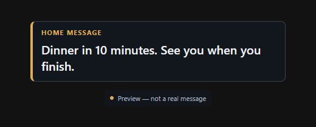
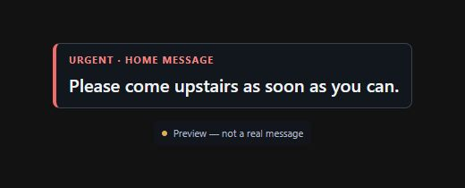
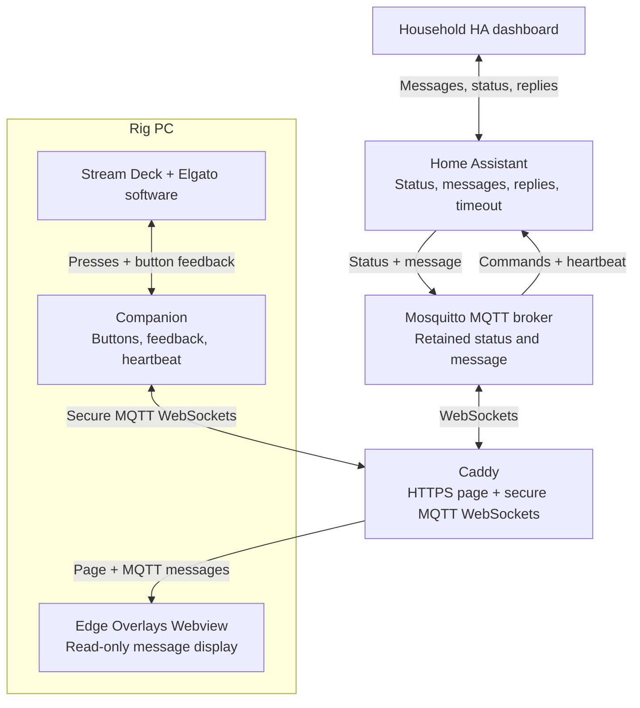

# A little household comms for a sim rig

**Stream Deck + Home Assistant + MQTT + a quiet in-game message overlay.**

I wanted a way to tell my wife whether I was available while racing, and a way for her to reach me without a shout across the house or a distracting phone notification. A couple of buttons on my Stream Deck turned out to be enough.

I already had Home Assistant, Mosquitto, Caddy, and Edge Overlays running for other reasons. This connects those pieces. It's a description of what I did, with the code and examples in case someone else wants to try it—not a claim that this is the best or most efficient solution.

## What it feels like

One Deck button cycles **Out of rig → Available → Racing**, with gray, green, and red feedback. My wife can see the status in Home Assistant and send a short normal or urgent message.

The message appears in a transparent overlay, and a Deck message button lights up. **Tap** means “seen”; **hold** means “coming shortly.” Either response goes back to HA and clears the message. No typing or switching away from the game.

| Normal | Urgent |
| --- | --- |
|  |  |

*Offline previews of the included page, with made-up messages. The preview notice is not shown during normal operation. Empty space around the card is transparent in the overlay host.*

## How the pieces fit

*Arrows show application data. Companion and the Webview both initiate their connections to Caddy. The rig does not need a Home Assistant API token.*

HA owns the confirmed status and current message. Companion publishes button commands and reads back the confirmed state for its colors. The overlay is a separate MQTT client with permission only to read messages. Caddy serves its files and proxies the WebSocket connections; it doesn't process messages or grant MQTT topic permissions.

There is **one current message**, not a queue. Sending another replaces it. A reply carries the message ID, so an old acknowledgement cannot clear a newer message. Clearing replaces the retained message state; it doesn't erase HA history or logs. A heartbeat every 30 seconds lets HA reset availability after 90 seconds without a check-in. That detects a missing Companion connection, not whether someone is physically sitting in the rig.

## Try your own version

Start with the [setup guide](docs/SETUP.md). The useful pieces are:

- [Overlay code](overlay/) — plain HTML/CSS/JavaScript, with its MQTT client included locally.
- [HA package](examples/home-assistant/simrig.yaml) and [dashboard](examples/home-assistant/dashboard.yaml).
- [Caddy example](examples/Caddyfile) and [broker permission example](examples/mosquitto/acl.example).
- Companion button, feedback, and heartbeat recipes in the guide.

The guide assumes you're comfortable editing configuration and already have the underlying services working. All hostnames are placeholders. Adapt the routing, certificates, credentials, and file paths to your own environment; don't replace an existing server configuration wholesale.

AI helped me work through the glue. A useful starting prompt for your own setup is:

> Help me adapt this project to my versions of Home Assistant, Companion, Mosquitto, Caddy, and Edge Overlays. Read the README, setup guide, and examples first. Ask about my existing configuration before changing it. Keep the MQTT topics and message format consistent, preserve existing clients and access restrictions, and work through one testable stage at a time. Use placeholders for secrets. Check current official documentation when UI labels or syntax differ.

## A few boundaries

This is a personal-project snapshot shared as-is. **I am not offering installation help, troubleshooting, ongoing maintenance, or compatibility guarantees.** Software versions and UI labels change; please adapt or fork it yourself.

The example uses borderless/windowed iRacing and Edge Overlays' Webview with **Transparent Background** enabled. The compact page centers the card inside the Webview; its host controls the outer area. In the version I tried, the corner handle changed uniform scale, not independent width and height. I have no benchmark or promise of zero FPS impact.

“Urgent” changes the accent color; it isn't a guaranteed emergency notification. An MQTT connection isn't proof that HA or the person at the rig has seen a message. ACK and Coming shortly are alternative replies here, not a two-step conversation.

The original files here are offered under [MIT](LICENSE). The bundled MQTT.js client has its [own MIT notice](overlay/vendor/MQTT-LICENSE.md). Product names belong to their respective projects; this is not an official integration.
